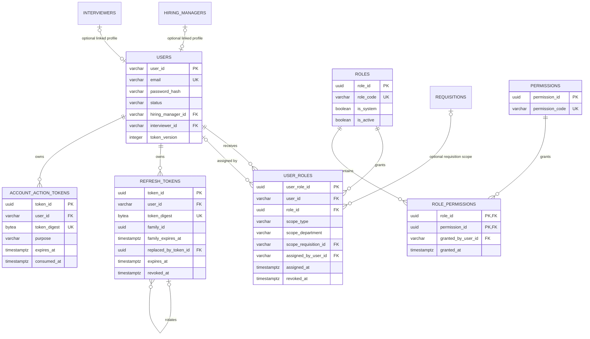

# Authentication and RBAC Design

**Status:** Design proposal only; implementation requires explicit approval.

This document proposes authentication, role-based permissions, and
resource-level authorization for the Recruitment Management System. It does not
change existing source code, models, migrations, tests, or database objects.

## 1. Existing system assessment

### Inspected components

- `src/models/` and `src/models/entities.py`: 21 recruitment ORM tables and
  their current relationships.
- `migrations/versions/f7aa32690f38_initial_recruitment_schema.py`,
  `migrations/env.py`, and `alembic.ini`: the initial migration and migration
  metadata setup.
- `database/schema.sql`, `docs/database_design.md`, `docs/data_dictionary.md`,
  `docs/er_diagram.md`, and `docs/business_rules.md`: implemented schema,
  workflow constraints, and relationship design.
- `src/api/app.py`, `src/api/router.py`, `src/api/routes/health.py`, and
  `src/core/`: application factory, registered routes, settings, logging, and
  exception handling.
- `src/database/base.py`, `src/database/session.py`, and `src/config.py`:
  shared SQLAlchemy metadata, session, engine, and environment configuration.
- `src/services/approval_service.py`: existing approval decision checks and
  `AuditEvent` creation.
- `requirements.txt`, tests, root documentation, and `backend/README.md`.

### Findings

- The live database has 21 recruitment tables plus the Alembic
  `alembic_version` table. No users, roles, permissions, authentication, or
  token tables exist.
- The database is at Alembic revision `f7aa32690f38` (head).
- No authentication or authorization models, login routes, password handling,
  token validation, or role checks exist.
- The current FastAPI application registers only `/`, `/health`, and
  `/health/db`. Recruitment route modules exist on disk but are not registered
  in the active router.
- `HiringManager` and `Interviewer` are existing staff profiles with unique
  employee codes and emails. `Scorecard.reviewer_id` is an FK to
  `interviewers.interviewer_id`; no login account is represented.
- Requisition and offer approval `approver_id`, historical `actor_id`,
  `Offer.created_by`, and `Interview.scheduled_by` are strings without user
  foreign keys. `AuditEvent` already records actor type/ID/name snapshots and
  supports polymorphic entity references.
- The database session and API settings already exist and should be reused.
  Authentication must not create another engine or session configuration.

### Compatibility decision

Treat the current 21-table recruitment schema as authoritative and additive.
Create new authentication tables that may reference existing
`hiring_managers`, `interviewers`, and `requisitions`. Do not rename or
reinterpret existing entities. Existing string-valued actor fields remain
unchanged in the initial RBAC migration; services will map authenticated
`user_id` values into those fields and check them against the current user.
Adding foreign keys to those legacy actor fields can be considered separately
after an explicit compatibility review.

## 2. Authentication architecture

### Provisioning and account lifecycle

- Disable public self-registration. An administrator provisions an account by
  email; the system sends a one-time activation link. The user chooses their
  password during activation.
- Bootstrap the first administrator through a documented, one-time
  out-of-band operation. Never ship a default administrator or password.
- Normalize email addresses before persistence and lookup; enforce a unique
  case-insensitive identity.
- Link an account to existing `HiringManager` and/or `Interviewer` profiles
  using optional unique FKs on the new `users` table. Linking does not copy or
  overwrite profile data.
- Account states are `PENDING_ACTIVATION`, `ACTIVE`, `LOCKED`, and `DISABLED`.
  Pending accounts cannot authenticate. Lockout is temporary and may be
  cleared only by its policy or an audited administrator action.

### Passwords and login

- Hash passwords with Argon2id using a maintained password-hashing library and
  calibrated memory/time parameters. Never store plaintext, reversible
  passwords, or unsalted fast hashes.
- Enforce a minimum 12-character password, permit long passphrases (at least
  64 characters), reject common/compromised passwords, and do not require
  arbitrary periodic changes. Require a new password after recovery or a
  suspected compromise.
- Compare hashes using the library's constant-time verification.
- Return the same generic `401` response for unknown email, incorrect
  password, disabled account, and inactive account. Do not reveal whether an
  email is registered.
- Apply rate limits by source IP and normalized account identifier. Track
  failed attempts and use increasing lockout delays with a maximum; do not
  allow attackers to permanently lock an account through unlimited attempts.
- Require MFA for privileged accounts (at minimum Admin and Approver) before
  production use. Prefer the organization's identity provider with MFA. If
  local authentication is used, approve an MFA-factor table and challenge
  flow before implementation; it is not included in the minimum schema below.

### Access and refresh tokens

- Short-lived signed JWT access tokens are appropriate for the API, provided
  they are not treated as authorization grants. Use an asymmetric signing key
  kept in a secret manager, explicit algorithm allow-list, and strict
  `iss`, `aud`, `exp`, `iat`, `sub`, and `jti` validation.
- Recommended access-token lifetime: 10 minutes. Claims include `sub` (user
  ID), `jti`, `iss`, `aud`, `iat`, `exp`, and `token_version`. Do not include
  mutable role/permission lists as the authoritative source of access.
- Check that the account is active and `token_version` is current for
  protected requests. Resolve current role assignments and resource scope
  from the database (or a tightly bounded cache with explicit invalidation).
  This supports immediate user disablement and role revocation.
- Use an opaque, cryptographically random refresh token with at least 256 bits
  of entropy. Persist only its SHA-256 digest (or keyed digest), never its raw
  value. Rotate it on every refresh using the atomic single-use procedure
  below. A consumed token presented again signals replay: revoke the entire
  token family and require login.
- Store refresh tokens in an `HttpOnly`, `Secure`, `SameSite=Lax` or stricter
  cookie scoped to `/api/v1/auth`. Use exact CORS origins, enable credentials
  only for those origins, and require CSRF protection (synchronizer/double
  submit token plus Origin validation) for cookie-authenticated refresh and
  logout requests. Do not store refresh tokens in browser local storage.
- Suggested refresh lifetime: 7 days, with an absolute 30-day family lifetime
  fixed when the family is created. Every token stores that same
  `family_expires_at`; an individual token's `expires_at` is the earlier of
  `issued_at + 7 days` and `family_expires_at`. Rotation never changes or
  extends `family_expires_at`. Revoke every token in the family on logout,
  password reset, account disablement, detected reuse, or administrator
  session revocation.
- Refresh rotation is one atomic database transaction. Lock the presented
  token row (`SELECT ... FOR UPDATE`) or use an equivalent compare-and-swap
  serialization mechanism; verify digest, expiry, revocation, user status,
  and family expiry; then mark the old token consumed/revoked, create exactly
  one replacement in the same family with the unchanged `family_expires_at`,
  link `replaced_by_token_id`, and commit before returning the new secret.
  Concurrent requests using the same token serialize: at most one can rotate
  successfully. A request that finds the token already consumed is replay;
  revoke all rows with that `family_id` in the same transaction, including any
  replacement just created by a racing request, and require fresh login.
- Keep access tokens in memory on browser clients. Never place tokens,
  passwords, reset tokens, or signing secrets in logs.

### Password recovery and invalidation

- Forgot-password requests return the same `202` response for known and
  unknown accounts. Send a random single-use reset token out of band; store
  only its digest and expire it after 30 minutes.
- Reset tokens are one-use and invalidated when consumed or superseded.
  Successful reset increments `token_version` and revokes all refresh-token
  families for the user.
- Deactivation and security-sensitive role changes increment
  `token_version` and revoke refresh tokens. Temporary access-token
  invalidation is bounded by the short access-token lifetime and the version
  check.
- Account activation uses the same one-time token mechanism with a distinct
  `purpose`; activation token expiry is 24 hours.

### Authentication is not authorization

A successful login establishes an identity only. Each protected operation must
separately check:

1. The account is active and the credential/token is valid.
2. The user has an active role grant containing the required permission.
3. The user is in scope for the requested resource.
4. Workflow/business constraints and separation-of-duties rules pass.

Possession of an access token or a broad role name alone never grants access
to every candidate, requisition, interview, scorecard, or offer.

## 3. Role definitions

Only the five requested roles are proposed. A user may have multiple roles;
permissions are additive, but resource scope and explicit separation-of-duties
checks still apply.

| Role | Intended responsibility | Default data scope |
|---|---|---|
| **Admin** | Provision/deactivate users, manage role and permission configuration, view system-wide recruitment data and audit events. | System-wide read and security administration. Business approvals are not granted merely by being an Admin; assign Approver separately. |
| **Recruiter** | Create/manage requisitions, candidates, and applications; make permitted stage changes; schedule/reschedule interviews; initiate offers. | Only explicitly granted departments or requisitions. |
| **Hiring Manager** | Review requisitions assigned to their existing HiringManager profile, review relevant candidates, provide decisions/recommendations, and view submitted interview feedback. | Requisitions whose `hiring_manager_id` matches the linked profile and applications/interviews under those requisitions. |
| **Interviewer** | View assigned interview schedule and the minimum candidate/requisition context needed for that interview; submit and view their own scorecards. | Interviews whose panel has an effective membership for the linked interviewer profile. |
| **Approver** | Decide assigned requisition/offer approvals and compensation exceptions. | Only approval records assigned to the user, plus the minimum related requisition/offer information necessary for the decision. |

No separate candidate, recruiter-manager, or superuser role is proposed at this
stage. If a distinct permission set is later required, add it only with a
specific business need.

## 4. Permission matrix

Legend: **M** = manage; **W** = create/update/execute within the specified
scope; **R** = read; **R\*** = limited or redacted read; **A** = decide only
assigned approval records; **—** = not granted. Matrix entries are defaults;
permissions are stored as explicit permission codes.

| Permission / action | Admin | Recruiter | Hiring Manager | Interviewer | Approver |
|---|---:|---:|---:|---:|---:|
| User management | M | — | — | — | — |
| Role management | M | — | — | — | — |
| Permission catalog read | R | — | — | — | — |
| System configuration | M | — | — | — | — |
| Requisition read | R | R, scoped | R, owned | — | R\*, assigned approval |
| Requisition creation | — | W | — | — | — |
| Requisition editing | — | W | R/request changes | — | R\* for assigned approval |
| Requisition approval | — | — | — | — | A |
| Candidate read | R, system-wide | R, scoped | R, owned requisitions | R\*, assigned interview | R\*, approval context |
| Candidate creation | — | W | — | — | — |
| Candidate editing | — | W | — | — | — |
| Application read | R, system-wide | R, scoped | R, owned requisitions | R\*, assigned interview only | R\*, approval context only |
| Application management | — | W | — | — | — |
| Application stage transitions | — | W, permitted transitions | —; may request | — | — |
| Hiring recommendation | — | — | W, owned requisitions | — | — |
| Interview read | R, system-wide | R, scoped | R, owned requisitions | R, own schedule | — |
| Interview scheduling | — | W | R, relevant requisitions | R, own schedule | — |
| Interview rescheduling | — | W | R, relevant requisitions | —; may request | — |
| Scorecard submission | — | — | — unless separately assigned Interviewer | W, assigned interview only | — |
| Scorecard viewing | R, system-wide | R\*, completion/recommendation metadata only | R, submitted feedback for owned requisitions | R, own scorecards | R\*, only if required by assigned approval |
| Offer creation | — | W | R\*, relevant requisition only | — | — |
| Offer read | R, system-wide | R, scoped | R\*, owned requisitions | — | R\*, assigned approval |
| Offer approval | — | — | — | — | A |
| Compensation exception approval | — | — | — | — | A, with explicit exception permission |
| Audit log access | R, system-wide | — | — | — | R\*, assigned decision events only if policy requires |

**Role assignment is not approval assignment.** An Approver must also be the
named approver on the specific `RequisitionApproval` or `Approval` record.
An Admin who must approve a business item receives the Approver role and a
specific assignment; that does not make Admin a universal approver.

An Interviewer has no independent `requisitions.read` permission. The
interviewer may receive only the minimum requisition context embedded in or
retrieved through an interview to which they are currently assigned; this
does not authorize requisition search, listing, or direct requisition reads.

### Canonical permission catalog and built-in role mapping

The following is the complete initial canonical permission catalog for the
matrix above. The `role_permissions` seed must contain exactly the listed
role/permission grants for the five built-in roles; permissions are not
implicitly inherited by a role name. A permission grant does not bypass the
scope or workflow check listed here. Admin receives system-wide read
permissions, but not recruitment write or approval permissions by default.

| Permission code | Description | Assigned roles | Required resource scope | Additional workflow / approval check |
|---|---|---|---|---|
| `users.manage` | Provision, list, read, and update user accounts and status. | Admin | Global; self-escalation and last-Admin safeguards apply. | Activation, verified email, status lifecycle, and session revocation rules apply. |
| `roles.manage` | Create/manage role definitions and assign/revoke role grants. | Admin | Global administration; grants limited to delegable permissions. | Cannot self-assign, mutate protected built-in roles, or remove the last active Admin. |
| `permissions.read` | Read the canonical permission catalog. | Admin | Global catalog only. | Read-only; no permission mutation. |
| `configuration.manage` | Manage system configuration. | Admin | Global configuration. | Sensitive configuration changes are audited; secrets are never returned. |
| `requisitions.read` | Read requisition fields needed by the user's assigned work. | Admin, Recruiter, Hiring Manager, Approver | Admin global; Recruiter granted department/requisition; Hiring Manager linked owner; Approver assigned approval only. | Approval access exposes only decision context. |
| `requisitions.create` | Create a requisition. | Recruiter | Explicit recruiter department or requisition scope. | New requisition starts in `DRAFT`; opening requires all required requisition approvals. |
| `requisitions.update` | Edit permitted requisition fields. | Recruiter | Explicit recruiter department/requisition scope. | Lifecycle transitions and protected/approved compensation changes follow business rules. |
| `requisitions.approve` | Decide an assigned requisition approval. | Approver | Exact assigned `RequisitionApproval` and related requisition. | Must match `approver_id`; decision immutable; requester/owner self-approval prohibited when separation policy applies. |
| `hiring.recommend` | Record a Hiring Manager's candidate/hiring recommendation. | Hiring Manager | Applications under requisitions owned by the linked HiringManager profile. | Recommendation is not an approval and cannot bypass stage or approval workflow gates. |
| `candidates.read` | Read candidate details required for assigned recruitment work. | Admin, Recruiter, Hiring Manager, Interviewer, Approver | Admin global audited; Recruiter scoped; Hiring Manager owned requisitions; Interviewer assigned interview; Approver assigned decision context. | Candidate fields are minimized/redacted; no global candidate search for non-admin roles. |
| `candidates.create` | Create a candidate profile. | Recruiter | Explicit recruiter department/requisition scope and authorized intake. | Validate duplicate identity and privacy/consent policy. |
| `candidates.update` | Update candidate profile fields. | Recruiter | Only candidates accessible through the recruiter's scoped applications/requisitions. | Sensitive/contact field edits are audited; no access via guessed IDs. |
| `applications.read` | Read applications and status needed for authorized work. | Admin, Recruiter, Hiring Manager, Interviewer, Approver | Admin global audited; Recruiter scoped; Hiring Manager owned requisitions; Interviewer assigned interview only; Approver assigned approval context. | Return only fields necessary to role's task. |
| `applications.manage` | Manage application records other than stage transitions. | Recruiter | Explicit recruiter department/requisition scope. | Candidate/requisition pair uniqueness and application lifecycle constraints apply. |
| `applications.transition` | Move an application through permitted stages. | Recruiter | Explicit recruiter department/requisition scope. | Only documented stage transitions; required reviews/approvals and terminal-state rules apply. |
| `interviews.read` | Read interview details and schedules. | Admin, Recruiter, Hiring Manager, Interviewer | Admin global audited; Recruiter scoped; Hiring Manager owned requisitions; Interviewer effective panel membership. | Interviewer sees only assigned interviews and minimum candidate context. |
| `interviews.schedule` | Schedule an interview. | Recruiter | Explicit recruiter department/requisition scope. | Service validates panel membership, each interviewer's availability, candidate availability, and conflicts transactionally. |
| `interviews.reschedule` | Reschedule an interview. | Recruiter | Explicit recruiter department/requisition scope. | Availability/conflict checks repeat; immutable reschedule history is appended with reason. |
| `scorecards.submit` | Create/submit a review scorecard. | Interviewer | Own linked interviewer profile, assigned interview, and active panel membership. | Reviewer identity must match; criteria/rating requirements apply; revisions are explicit and immutable after submission. |
| `scorecards.read` | Read scorecards and review feedback. | Admin, Recruiter, Hiring Manager, Interviewer, Approver | Admin global audited; Recruiter metadata only in scope; Hiring Manager submitted feedback for owned requisitions; Interviewer own scorecards; Approver only when decision policy requires. | Draft content is not visible to unauthorized reviewers; least-privilege fields apply. |
| `offers.read` | Read offer terms and status required for authorized work. | Admin, Recruiter, Hiring Manager, Approver | Admin global audited; Recruiter scoped; Hiring Manager owned requisition; Approver assigned approval. | Compensation fields are restricted to users with a business need. |
| `offers.create` | Initiate a new offer version. | Recruiter | Explicit recruiter department/requisition scope. | Offer snapshots compensation band; required standard and exception approvals gate approval/send/acceptance. |
| `offers.approve` | Decide an assigned standard offer approval. | Approver | Exact assigned `Approval` and related offer. | Must match `approver_id`; recruiter/creator cannot approve own offer; immutable ordered decision workflow applies. |
| `compensation_exceptions.approve` | Decide an assigned compensation exception approval. | Approver | Exact assigned `Approval` with type `COMPENSATION_EXCEPTION`. | Must match assigned approver; documented exception reason and separation-of-duties checks apply. |
| `audit.read` | Read audit events. | Admin, Approver | Admin global; Approver only assigned approval-related event records if policy allows. | Read-only, audited access; unrelated candidate data is not exposed. |

Seed mapping summary, consistent with the permission matrix:

| Built-in role | Permission codes |
|---|---|
| **Admin** | `users.manage`, `roles.manage`, `permissions.read`, `configuration.manage`, `requisitions.read`, `candidates.read`, `applications.read`, `interviews.read`, `scorecards.read`, `offers.read`, `audit.read` |
| **Recruiter** | `requisitions.read`, `requisitions.create`, `requisitions.update`, `candidates.read`, `candidates.create`, `candidates.update`, `applications.read`, `applications.manage`, `applications.transition`, `interviews.read`, `interviews.schedule`, `interviews.reschedule`, `scorecards.read`, `offers.read`, `offers.create` |
| **Hiring Manager** | `requisitions.read`, `candidates.read`, `applications.read`, `hiring.recommend`, `interviews.read`, `scorecards.read`, `offers.read` |
| **Interviewer** | `candidates.read`, `applications.read`, `interviews.read`, `scorecards.submit`, `scorecards.read` |
| **Approver** | `requisitions.read`, `requisitions.approve`, `candidates.read`, `applications.read`, `scorecards.read`, `offers.read`, `offers.approve`, `compensation_exceptions.approve`, `audit.read` |

These are role defaults, not scope grants. User-role grants and profile/
resource relationships still limit every scoped permission. A Hiring Manager
recommendation is a recorded recommendation, not an approval or unrestricted
application-stage write.

### Data-level authorization

- **Recruiter:** Filter every requisition query to active `user_roles` scope:
  department or explicit requisition. Candidate/application visibility is
  derived through an authorized application/requisition, not by guessing IDs.
  A recruiter with no scope receives no recruitment records.
- **Hiring Manager:** Require a linked `hiring_manager_id` and match it to
  `Requisition.hiring_manager_id`. Do not grant visibility to other managers'
  candidates or requisitions by changing a path parameter.
- **Interviewer:** Require a linked `interviewer_id`, an effective
  `PanelInterviewer` membership, and an interview assigned to that panel.
  Expose only candidate details and minimum requisition context required for
  that interview. This is interview-scoped context, not independent
  requisition-read access. Scorecard submission and reads are limited to that
  interview and reviewer's identity.
- **Approver:** Resolve the assigned approval record first, then expose only
  its related requisition/offer compensation and decision context. Do not
  grant global candidate or application search.
- **Admin:** System-wide read access is audited. Candidate contact and other
  sensitive fields should be masked unless a specific administrative task
  requires them.
- Enforce scope in service/repository queries before returning data. Do not
  rely on frontend hiding, route IDs, or post-fetch filtering. Return `404`
  for inaccessible resource IDs where doing so avoids resource enumeration.

## 5. Proposed database design

All tables below are additive. Use PostgreSQL `TIMESTAMPTZ` for instants,
`UUID` for internal association/session identifiers, and normalized lowercase
emails. Do not put credentials or role state on candidate, hiring-manager, or
interviewer records.

### Entity relationships



### Proposed tables, columns, and constraints

#### `users`

| Column | PostgreSQL type | Key / nullability | Constraints and validation |
|---|---|---|---|
| `user_id` | `VARCHAR(80)` | PK, not null | Stable `USR-<UUID>` identifier; same type as existing actor ID columns. |
| `email` | `VARCHAR(320)` | not null | Unique on `lower(email)`; validated and normalized before storage. |
| `display_name` | `VARCHAR(200)` | not null | Trimmed and non-empty. |
| `password_hash` | `VARCHAR(255)` | nullable | Argon2id encoded value; null only before activation; never plaintext. |
| `status` | `VARCHAR(24)` | not null | Check: `PENDING_ACTIVATION`, `ACTIVE`, `LOCKED`, `DISABLED`; default `PENDING_ACTIVATION`. |
| `hiring_manager_id` | `VARCHAR(80)` | nullable FK → `hiring_managers.hiring_manager_id` | Unique when non-null; allows at most one login per profile. |
| `interviewer_id` | `VARCHAR(80)` | nullable FK → `interviewers.interviewer_id` | Unique when non-null; allows at most one login per profile. |
| `email_verified_at` | `TIMESTAMPTZ` | nullable | Set on activation/verified email process. |
| `failed_login_count` | `INTEGER` | not null | Default 0; non-negative; reset only on successful login or policy expiry. |
| `locked_until` | `TIMESTAMPTZ` | nullable | Temporary lock expiry; account lock policy is service-enforced. |
| `last_login_at` | `TIMESTAMPTZ` | nullable | Update after successful authentication. |
| `password_changed_at` | `TIMESTAMPTZ` | nullable | Set on activation and each password change. |
| `token_version` | `INTEGER` | not null | Default 1; positive; increment to invalidate access tokens. |
| `created_at`, `updated_at` | `TIMESTAMPTZ` | not null | `CURRENT_TIMESTAMP`; update timestamp on mutation. |

Add a check requiring `password_hash IS NULL` only for
`PENDING_ACTIVATION`, and requiring a password hash for `ACTIVE`, `LOCKED`, or
`DISABLED`. Add indexes for status and profile links. Account status and
`token_version` updates must be transactional with refresh-session revocation.

#### `roles`

| Column | PostgreSQL type | Key / nullability | Constraints and validation |
|---|---|---|---|
| `role_id` | `UUID` | PK, not null | Generated UUID. |
| `role_code` | `VARCHAR(60)` | not null | Unique, uppercase stable code (`ADMIN`, `RECRUITER`, `HIRING_MANAGER`, `INTERVIEWER`, `APPROVER`). Immutable for system roles. |
| `name` | `VARCHAR(100)` | not null | Non-empty display label. |
| `description` | `TEXT` | not null | Documented intent and scope. |
| `is_system` | `BOOLEAN` | not null | Default false; true for built-in roles. |
| `is_active` | `BOOLEAN` | not null | Default true; inactive roles cannot be assigned. |
| `created_at`, `updated_at` | `TIMESTAMPTZ` | not null | `CURRENT_TIMESTAMP`. |

Index `is_active`. Do not delete system roles; deactivation/removal of
permissions is audited and must not leave the system without an active Admin.

#### `permissions`

| Column | PostgreSQL type | Key / nullability | Constraints and validation |
|---|---|---|---|
| `permission_id` | `UUID` | PK, not null | Generated UUID. |
| `permission_code` | `VARCHAR(120)` | not null | Unique stable code. Seed exactly the canonical catalog: `users.manage`, `roles.manage`, `permissions.read`, `configuration.manage`, `requisitions.read`, `requisitions.create`, `requisitions.update`, `requisitions.approve`, `hiring.recommend`, `candidates.read`, `candidates.create`, `candidates.update`, `applications.read`, `applications.manage`, `applications.transition`, `interviews.read`, `interviews.schedule`, `interviews.reschedule`, `scorecards.submit`, `scorecards.read`, `offers.read`, `offers.create`, `offers.approve`, `compensation_exceptions.approve`, `audit.read`. |
| `description` | `TEXT` | not null | Human-readable action and scope meaning. |
| `is_active` | `BOOLEAN` | not null | Default true; inactive permission cannot be newly granted. |
| `created_at` | `TIMESTAMPTZ` | not null | `CURRENT_TIMESTAMP`. |

Index `is_active`. Permission codes are application policy identifiers and
must not be user-defined arbitrary SQL or route expressions.

#### `user_roles`

| Column | PostgreSQL type | Key / nullability | Constraints and validation |
|---|---|---|---|
| `user_role_id` | `UUID` | PK, not null | Generated UUID. |
| `user_id` | `VARCHAR(80)` | FK → `users.user_id`, not null | Role recipient. |
| `role_id` | `UUID` | FK → `roles.role_id`, not null | Must be active when assigned. |
| `scope_type` | `VARCHAR(20)` | not null | Check: `GLOBAL`, `DEPARTMENT`, `REQUISITION`, `RESOURCE`. `RESOURCE` resolves via existing ownership/assignment relationships. |
| `scope_department` | `VARCHAR(100)` | nullable | Required only when `scope_type='DEPARTMENT'`. |
| `scope_requisition_id` | `VARCHAR(80)` | nullable FK → `requisitions.requisition_id` | Required only when `scope_type='REQUISITION'`. |
| `assigned_by_user_id` | `VARCHAR(80)` | nullable FK → `users.user_id` | Null only for audited bootstrap/system assignments. |
| `assigned_at` | `TIMESTAMPTZ` | not null | Default `CURRENT_TIMESTAMP`. |
| `revoked_at` | `TIMESTAMPTZ` | nullable | Null means active; revocation is append-preserving, not deletion. |

Use a check that permits exactly: `GLOBAL`/`RESOURCE` with both scope values
null, `DEPARTMENT` with department only, or `REQUISITION` with requisition FK
only. Prevent duplicate active grants even when nullable scope values are
`NULL`; include `scope_type` in the uniqueness key. On supported PostgreSQL
versions, use a partial unique index with `NULLS NOT DISTINCT`:

```sql
CREATE UNIQUE INDEX uq_user_roles_active_scope
ON user_roles (
    user_id,
    role_id,
    scope_type,
    scope_department,
    scope_requisition_id
) NULLS NOT DISTINCT
WHERE revoked_at IS NULL;
```

For PostgreSQL versions without `NULLS NOT DISTINCT`, use an expression-based
unique index that replaces each nullable scope column with a non-colliding,
type-safe sentinel, while retaining `scope_type` and the `revoked_at IS NULL`
predicate. The selected sentinel must be prohibited as a real scope value.
Create indexes on `(user_id, revoked_at)`, `(role_id, revoked_at)`, and scope
columns. Enforce role/scope compatibility in the service (e.g. Admin is
global; Interviewer, Hiring Manager, and Approver are resource-scoped). Role
changes are audited.

#### `role_permissions`

| Column | PostgreSQL type | Key / nullability | Constraints and validation |
|---|---|---|---|
| `role_id` | `UUID` | PK component, FK → `roles.role_id`, not null | Existing role. |
| `permission_id` | `UUID` | PK component, FK → `permissions.permission_id`, not null | Existing permission. |
| `granted_by_user_id` | `VARCHAR(80)` | nullable FK → `users.user_id` | Null only for migration/bootstrap seed. |
| `granted_at` | `TIMESTAMPTZ` | not null | Default `CURRENT_TIMESTAMP`. |

Composite primary key `(role_id, permission_id)` prevents duplicate grants.
Index `permission_id`. Role/permission changes are audited; system role
definitions are immutable except through reviewed policy migrations.

#### `refresh_tokens`

| Column | PostgreSQL type | Key / nullability | Constraints and validation |
|---|---|---|---|
| `token_id` | `UUID` | PK, not null | Generated UUID. |
| `user_id` | `VARCHAR(80)` | FK → `users.user_id`, not null | Token owner. |
| `token_digest` | `BYTEA` | not null | Unique 32-byte digest of a random refresh token; raw token is never stored. |
| `family_id` | `UUID` | not null | Stable identifier for one rotating session family. |
| `issued_at` | `TIMESTAMPTZ` | not null | Default `CURRENT_TIMESTAMP`. |
| `family_expires_at` | `TIMESTAMPTZ` | not null | Immutable absolute expiry set once on the first token (`first token issued_at + 30 days`); identical on every token in the family. |
| `expires_at` | `TIMESTAMPTZ` | not null | Must be after `issued_at` and no later than `family_expires_at`; set to the earlier of `issued_at + 7 days` and family expiry. |
| `last_used_at` | `TIMESTAMPTZ` | nullable | Set on successful rotation. |
| `revoked_at` | `TIMESTAMPTZ` | nullable | Set on logout/revocation/reuse response. |
| `replaced_by_token_id` | `UUID` | nullable self-FK → `refresh_tokens.token_id` | New token created by rotation; old record remains. |
| `user_agent` | `VARCHAR(500)` | nullable | Optional diagnostic metadata; do not store secrets. |

Add a database check `issued_at < expires_at AND expires_at <=
family_expires_at`. The service must verify that all rows sharing a
`family_id` have the same `family_expires_at`; this cross-row invariant is not
expressible as a row-level check. Create a unique index on `token_digest`; indexes on
`(user_id, revoked_at, expires_at)` and `(family_id, revoked_at)`. All tokens
in a family carry the same `family_expires_at`. Rotation calculates the new
token expiry as `LEAST(rotation_time + INTERVAL '7 days', family_expires_at)`
and fails if the family has expired; it never creates a new family or moves
the absolute expiry. Revocation updates every token row with the same
`family_id`, including its current replacement.

#### Atomic refresh rotation and concurrency

Refresh consumption, replacement creation, and token-family security state
changes are serialized in one transaction:

1. Hash the presented opaque token and locate its row. Lock that row with
   `SELECT ... FOR UPDATE`, or use an equivalent conditional update/CAS that
   permits one consumer only.
2. Verify token digest, `expires_at`, `family_expires_at`, `revoked_at`,
   replacement/consumption state, owning account status, and family state.
3. If unused and valid, mark the presented token consumed (`last_used_at`)
   and link it to exactly one replacement; insert that replacement with
   unchanged `family_id` and `family_expires_at`, and expiry no later than
   seven days from rotation or family expiry.
4. Commit before returning the new raw refresh-token secret. Only the digest
   is persisted.
5. Concurrent requests using the same token serialize. Exactly one request
   may create a replacement. A request that observes an already consumed
   token is replay, not a second successful refresh: revoke all family rows
   in the same transaction, including the replacement created by the winner,
   commit the revocation, and require login. The losing request receives a
   generic `401`; it must not receive the replacement secret.

Logout, password reset, account disablement, administrator revocation, and
replay response revoke the complete family, not only the presented row.

#### `account_action_tokens`

| Column | PostgreSQL type | Key / nullability | Constraints and validation |
|---|---|---|---|
| `token_id` | `UUID` | PK, not null | Generated UUID. |
| `user_id` | `VARCHAR(80)` | FK → `users.user_id`, not null | Intended account. |
| `token_digest` | `BYTEA` | not null | Unique digest of a high-entropy one-time token; raw token never stored. |
| `purpose` | `VARCHAR(24)` | not null | Check: `ACTIVATION` or `PASSWORD_RESET`. |
| `issued_at` | `TIMESTAMPTZ` | not null | Default `CURRENT_TIMESTAMP`. |
| `expires_at` | `TIMESTAMPTZ` | not null | Must be after issue time; activation 24 hours, reset 30 minutes. |
| `consumed_at` | `TIMESTAMPTZ` | nullable | Non-null after successful single use. |

Create a unique index on `token_digest` and an index on
`(user_id, purpose, expires_at)`. Invalidate prior outstanding tokens for the
same purpose when issuing a replacement. Recovery requests must not disclose
account existence.

### Relationship to existing recruitment entities

- `users.hiring_manager_id` and `users.interviewer_id` are optional, unique
  FKs into existing profiles. These links support manager ownership and
  interviewer panel membership without altering those tables.
- `user_roles.scope_requisition_id` is an optional FK into existing
  `requisitions`.
- A Hiring Manager's authorization is checked through the linked profile and
  `Requisition.hiring_manager_id`.
- An Interviewer's schedule and scorecards are checked through the linked
  profile, `PanelInterviewer`, `Interview`, and `Scorecard.reviewer_id`.
- Approver identity is compared with the assigned string `approver_id` on
  `RequisitionApproval` or `Approval`; the authenticated `user_id` must match.
  The existing columns are not FKs and are not changed by this proposal.
- `AuditEvent.actor_id`, application/interview history actor IDs, offer
  `created_by`, and interview `scheduled_by` store authenticated `user_id`
  values as strings. `AuditEvent` remains the general immutable audit record.
  Do not store passwords, access tokens, refresh tokens, or reset tokens in
  audit events.

## 6. API endpoint specification

All proposed endpoints use `/api/v1`. Authentication endpoints are public
except where noted; administration endpoints require both a valid active
account and the listed permission. Request bodies contain only the fields
shown. Access-token responses use `Cache-Control: no-store`.

### Authentication

| Method and path | Purpose / permission | Request | Response and status codes |
|---|---|---|---|
| `POST /api/v1/auth/login` | Authenticate local account; no role permission before login. | `{ "email": "string", "password": "string" }` | `200`: `{ "access_token": "JWT", "token_type": "bearer", "expires_in": 600 }` and sets refresh cookie. `401` generic invalid/inactive credentials; `429` rate limit. |
| `POST /api/v1/auth/refresh` | Rotate refresh token; requires valid refresh cookie and CSRF/origin validation. | No body; refresh cookie and CSRF header. | `200`: new access token, rotates cookie. `401` expired/revoked/reused token; `403` CSRF/origin failure; `429` rate limit. |
| `POST /api/v1/auth/logout` | Revoke current refresh-token family; requires valid session or refresh cookie and CSRF/origin validation. | No body; cookie and CSRF header. | `204`; idempotent when already logged out. `403` CSRF/origin failure. |
| `POST /api/v1/auth/forgot-password` | Start password recovery; no authenticated permission. | `{ "email": "string" }` | `202`: generic accepted response regardless of account existence. `429` rate limit. |
| `POST /api/v1/auth/reset-password` | Consume a password-reset token. | `{ "token": "string", "new_password": "string" }` | `204`; `400` invalid/expired/used token or password policy failure; `429` rate limit. Increments token version and revokes sessions. |
| `POST /api/v1/auth/activate` | Accept an administrator invitation and set initial password. | `{ "token": "string", "new_password": "string" }` | `204`; `400` invalid/expired/used token; `409` account is no longer pending. |
| `GET /api/v1/auth/me` | Return the authenticated user's identity and effective role/permission summary; requires valid access token. | No body. | `200`: `{ "user_id", "email", "display_name", "status", "roles": [], "permissions": [] }`; `401` invalid/expired token. Returned permissions are for UI display only, not client-side enforcement. |

### User administration

| Method and path | Purpose / permission | Request | Response and status codes |
|---|---|---|---|
| `POST /api/v1/users` | Provision account and send activation email; `users.manage`. | `{ "email": "string", "display_name": "string", "hiring_manager_id": "optional string", "interviewer_id": "optional string" }` | `201`: user summary with `PENDING_ACTIVATION`; `400` invalid profile; `403` forbidden; `409` duplicate email/profile. Password is never accepted here. |
| `GET /api/v1/users` | Paginated user list; `users.manage`. | Query: `page`, `page_size`, optional `status`, `role_code`. | `200`: `{ "items": [], "page", "page_size", "total" }`; `403` forbidden. |
| `GET /api/v1/users/{user_id}` | Get account and role grants; `users.manage`. | Path ID. | `200` user summary and grants; `403` forbidden; `404` not found. Never return hashes, tokens, or MFA secrets. |
| `PATCH /api/v1/users/{user_id}` | Update mutable profile fields; `users.manage`. | `{ "display_name": "optional string" }` | `200` updated summary; `400` invalid; `403` forbidden; `404` not found. Login email changes require a separate verified workflow. |
| `PATCH /api/v1/users/{user_id}/status` | Disable/reactivate eligible account; `users.manage`. | `{ "status": "ACTIVE or DISABLED", "reason": "string" }` | `200` updated status; `400` invalid lifecycle (e.g. direct activation before invite accepted); `403` forbidden; `404` not found; `409` last active Admin protection. Revokes refresh tokens and increments token version. |
| `PUT /api/v1/users/{user_id}/roles` | Replace active role grants atomically; `users.manage`. | `{ "grants": [{ "role_code": "string", "scope_type": "GLOBAL|DEPARTMENT|REQUISITION|RESOURCE", "scope_department": "optional", "scope_requisition_id": "optional" }] }` | `200` active grant list; `400` invalid scope/role; `403` forbidden; `404` not found; `409` self-escalation/last Admin/separation-of-duties conflict. Audit all additions and revocations. |

### Role and permission administration

| Method and path | Purpose / permission | Request | Response and status codes |
|---|---|---|---|
| `GET /api/v1/roles` | List roles and permission codes; `roles.manage`. | Query: optional `active_only`. | `200`: role summaries with permissions; `403` forbidden. |
| `POST /api/v1/roles` | Create a custom role; `roles.manage`. | `{ "role_code": "string", "name": "string", "description": "string", "permission_codes": [] }` | `201` role summary; `400` invalid/unknown permission; `403` forbidden; `409` duplicate code or permission escalation. |
| `PATCH /api/v1/roles/{role_id}` | Update custom role name/description, active state, and permission set; `roles.manage`. | `{ "name": "optional", "description": "optional", "is_active": "optional bool", "permission_codes": "optional list" }` | `200` role summary; `400` invalid; `403` forbidden; `404` not found; `409` built-in role mutation or privilege escalation. |
| `GET /api/v1/permissions` | Read canonical permission catalog; `permissions.read` (granted to Admin). | No body. | `200`: permission catalog; `403` forbidden. |

Built-in role codes and their core permission policy are seeded through a
reviewed migration or controlled bootstrap. Built-in role codes cannot be
renamed or removed through the API. Custom roles may only contain permissions
the actor is authorized to delegate. No API accepts arbitrary permission
expressions.

## 7. Security and business rules

### Least privilege and escalation prevention

- Deny by default. Each route declares one or more permission codes and each
  service applies resource scope before reading or mutating data.
- A user cannot assign roles to themselves, modify their own role grants, or
  grant permissions they do not have authority to delegate.
- Do not allow the last active Admin account to be disabled or stripped of its
  Admin grant. Require re-authentication for high-risk user/role changes and
  record actor, target, reason, and before/after state.
- A recruiter cannot approve an offer they created. A requisition approver
  cannot approve a requisition they initiated or own as Hiring Manager when
  the configured separation-of-duties policy applies. Check this in the
  decision service in the same transaction as the approval update.
- Approver assignment, approval type, sequence, and decision lifecycle remain
  governed by existing approval services and workflow rules; RBAC does not
  bypass them.
- Role removal/deactivation, user deactivation, password reset, and refresh
  reuse revoke sessions and invalidate access tokens as described above.

### Candidate privacy and audit

- Candidate data is sensitive. Return only the fields required for the user's
  workflow. Interviewers do not receive unrestricted candidate search,
  contact details, compensation, or unrelated application history.
- Apply data minimization to logs, audit records, error messages, exports, and
  Swagger examples. Never log passwords, tokens, full reset URLs, or
  authentication headers.
- Record user provisioning, activation/deactivation, failed/successful
  authentication where appropriate, password reset completion, role/permission
  changes, approval decisions, and sensitive data access in append-only audit
  records. Reuse `AuditEvent` for attributable business/security actions;
  operational rate-limit telemetry may use the structured security logger.
- Preserve `AuditEvent` as the existing polymorphic mechanism. Its
  entity-target validation and actor attribution remain service-level, as the
  schema intentionally has no FK for polymorphic entity IDs.
- Retain audit and token data according to an approved privacy/retention
  policy; purge expired/revoked token records on a scheduled retention job,
  while preserving security-relevant audit events.

### Transport, secrets, and operational controls

- Require HTTPS outside local development. Store database credentials,
  JWT signing keys, token-digest pepper (if used), and email-provider
  credentials in a secret manager or protected environment configuration.
- Rotate signing keys with `kid` support; accept old verification keys only
  for a bounded overlap. Define a response plan for key compromise.
- Use exact trusted CORS origins; do not enable wildcard origins with
  credentials. The current foundation has credentials disabled and permits
  only GET, so authentication requires a deliberate CORS/method/header update
  at implementation time.
- Protect login, refresh, forgot/reset, and activation endpoints with
  per-IP/per-account rate limits and request-size limits. Use generic errors
  and avoid timing differences that reveal account existence.
- Set security headers, `Cache-Control: no-store` on sensitive responses, and
  keep Swagger authentication examples free of real tokens or secrets.

## 8. Testing strategy

Use isolated test databases/transactions and mocked email delivery. Never run
auth tests against the configured production database. Include unit,
integration, and authorization matrix tests for:

1. Password hashing and verification: correct password succeeds; plaintext is
   absent; wrong password fails; hash algorithm/parameters are valid.
2. Valid login and normalized email lookup; wrong password, unknown user,
   pending, locked, and disabled users receive non-enumerating failures.
3. Failed-login counters, progressive lockout, rate limiting, and successful
   login reset policy.
4. JWT signature, issuer, audience, algorithm allow-list, malformed claims,
   expired token, not-yet-valid token, token-version mismatch, and disabled
   account.
5. Refresh-token rotation, expiration, logout revocation, expired/revoked
   token rejection, replay detection, family-wide revocation, and
   simultaneous refresh race behavior. Add a concurrency integration test
   that releases two requests with the same valid refresh token at once:
   assert only one transaction creates a replacement, the other detects
   replay, exactly one request receives a new token response, the losing
   request receives a generic `401`, and every token in that family (including
   the replacement) is revoked after replay detection. Also assert all family
   rows retain the original `family_expires_at` and no rotation extends it.
6. Forgot-password response is identical for present/absent accounts;
   valid, invalid, expired, used, and superseded reset/activation tokens;
   password policy; reset invalidates existing sessions.
7. Missing authentication (`401`), authenticated but unauthorized
   (`403`/privacy-preserving `404`), and each role/permission combination.
8. Recruiter department/requisition filtering and prevention of cross-scope
   access through altered IDs.
9. Hiring Manager access only through the linked profile's requisitions;
   interviewer access only to currently assigned panel interviews and own
   scorecards; Approver access only to assigned approvals.
10. Candidate field redaction by role and absence of unauthorized data from
    errors, logs, and API responses.
11. Separation of duties: recruiter cannot approve their own offer; requester
    or owning Hiring Manager cannot approve their own requisition when policy
    forbids it; unrelated users cannot decide assigned approvals.
12. Role escalation: self-assignment, permission grants beyond delegation
    authority, built-in role mutation, and removal/deactivation of the last
    Admin are rejected and audited.
13. Audit event creation for account, role, permission, and sensitive access
    changes; audit rows remain append-only.
14. CORS preflight, trusted-origin credential behavior, CSRF failures for
    refresh/logout, and security response headers.

## 9. Alembic migration plan

The current head is `f7aa32690f38`. After design approval:

1. Implement authentication models under the existing `src/models/` and
   import them through the established model package and Alembic metadata.
2. Generate a new additive migration with the current revision as
   `down_revision`. Review all generated DDL; do not modify or regenerate the
   existing initial migration.
3. Create the seven minimum tables: `users`, `roles`, `permissions`,
   `user_roles`, `role_permissions`, `refresh_tokens`, and
   `account_action_tokens`. Add only the documented FKs to existing profile
   and requisition tables; do not alter existing recruitment columns.
4. Add database constraints and indexes, including a partial active-grant
   unique index that includes `scope_type` and treats nullable scope columns
   as equal (`NULLS NOT DISTINCT` or the documented expression-index
   fallback). Add refresh-token expiry constraints and indexes. Seed only the
   five built-in roles and the exact canonical role/permission mapping in
   this document. Never seed a real user, password, or default secret.
5. Apply first to an isolated test database and staging clone. Review expected
   schema diff and downgrade behavior. Back up the target before production
   migration.
6. Before application, verify the live table inventory and current head. After
   application, verify the new table definitions, constraints, FKs, indexes,
   seeded policy records, and no changes to the 21 recruitment tables.
7. Run `alembic check`, the database verification script, and tests. Do not
   downgrade by dropping tables if they contain user/session records; any
   rollback requires an explicit data-preservation plan.

The optional local MFA extension is a separate approved migration and is not
part of these seven minimum tables.

## 10. Implementation sequence after approval

1. Confirm production identity-provider/MFA choice, token lifetimes, CORS
   deployment origins, and approval separation-of-duties policy.
2. Add auth/role models and migration; seed built-in roles and permission
   policy without creating users.
3. Add password hashing, provisioning/activation, login, and security
   rate-limits; add unit tests.
4. Add JWT validation and opaque rotating refresh sessions, logout, token
   invalidation, and password recovery.
5. Add current-user and permission dependencies; centralize resource-scope
   predicates and separation-of-duties checks.
6. Add user/role administration endpoints with audit events and delegation
   limits.
7. Register only the approved auth/admin routers under `/api/v1`; preserve
   health endpoints and do not register unreviewed recruitment routes.
8. Add CORS credentials only for exact trusted origins, CSRF protections, and
   production secret configuration.
9. Run isolated tests, migration verification, permission-matrix tests, and a
   security review before deployment.

## 11. Assumptions and decisions requiring approval

- Accounts are internal staff accounts provisioned by administrators; no
  candidate self-service account is in scope.
- Local email/password is the proposed baseline because password reset and
  activation are required. If a corporate OIDC provider is available, prefer
  it for authentication and MFA while retaining local role/resource
  authorization.
- Admin is a security/data-administration role, not an implicit business
  approver. An Admin must also hold an assigned Approver role to make business
  decisions.
- Recruiter scopes are explicit department or requisition grants because the
  current schema has no recruiter ownership field.
- Existing actor IDs remain unmodified and are service-validated in the first
  additive migration. A future FK migration may be considered only after
  reviewing existing non-empty data and ID compatibility.
- MFA provider/implementation must be selected before production auth
  implementation; Admin and Approver MFA is required for production use.
- Password, refresh-session, and audit retention details may need adjustment
  to organizational policy and applicable privacy law.

## 12. Scope confirmation

This deliverable is architecture and documentation only. No Python source,
SQLAlchemy model, migration, test, database schema, database data, or
configuration was changed.
