# Recruitment Database ER Diagram

This diagram represents the implemented PostgreSQL schema. `PK` and `FK` mark
primary and foreign keys. `UQ` marks important unique constraints. Solid
relationship lines show PostgreSQL foreign-key cardinalities. Dotted
AuditEvent lines are conceptual polymorphic references, not foreign keys.

```mermaid
erDiagram
    HIRING_MANAGER ||--o{ REQUISITION : manages
    REQUISITION ||--o{ SKILL_REQUIREMENT : defines
    SKILL ||--o{ SKILL_REQUIREMENT : classifies
    REQUISITION ||--o{ APPLICATION : receives
    CANDIDATE ||--o{ APPLICATION : submits
    CANDIDATE ||--o{ CANDIDATE_SKILL : has
    SKILL ||--o{ CANDIDATE_SKILL : describes
    APPLICATION ||--o{ INTERVIEW : schedules
    INTERVIEW_PANEL ||--o{ INTERVIEW : assigned_to
    INTERVIEW_PANEL ||--o{ PANEL_INTERVIEWER : includes
    INTERVIEWER ||--o{ PANEL_INTERVIEWER : joins
    INTERVIEWER ||--o{ AVAILABILITY : declares
    INTERVIEW ||--o{ SCORECARD : evaluated_by
    INTERVIEWER ||--o{ SCORECARD : reviews
    SCORECARD ||--o{ SCORECARD_CRITERIA : contains
    EVALUATION_CRITERION ||--o{ SCORECARD_CRITERIA : scores
    APPLICATION ||--o{ OFFER : receives
    REQUISITION ||--o{ REQUISITION_APPROVAL : requires
    OFFER ||--o{ APPROVAL : requires
    REQUISITION_APPROVAL o|--o{ REQUISITION_APPROVAL : supersedes
    OFFER o|--o{ OFFER : supersedes
    SCORECARD o|--o{ SCORECARD : revises
    APPLICATION ||--o{ APPLICATION_STAGE_HISTORY : records
    INTERVIEW ||--o{ INTERVIEW_RESCHEDULE_HISTORY : records
    HIRING_MANAGER ||..o{ AUDIT_EVENT : audited_by
    REQUISITION ||..o{ AUDIT_EVENT : audited_by
    REQUISITION_APPROVAL ||..o{ AUDIT_EVENT : audited_by
    SKILL ||..o{ AUDIT_EVENT : audited_by
    SKILL_REQUIREMENT ||..o{ AUDIT_EVENT : audited_by
    CANDIDATE ||..o{ AUDIT_EVENT : audited_by
    CANDIDATE_SKILL ||..o{ AUDIT_EVENT : audited_by
    APPLICATION ||..o{ AUDIT_EVENT : audited_by
    INTERVIEW_PANEL ||..o{ AUDIT_EVENT : audited_by
    INTERVIEWER ||..o{ AUDIT_EVENT : audited_by
    PANEL_INTERVIEWER ||..o{ AUDIT_EVENT : audited_by
    AVAILABILITY ||..o{ AUDIT_EVENT : audited_by
    INTERVIEW ||..o{ AUDIT_EVENT : audited_by
    EVALUATION_CRITERION ||..o{ AUDIT_EVENT : audited_by
    SCORECARD ||..o{ AUDIT_EVENT : audited_by
    SCORECARD_CRITERIA ||..o{ AUDIT_EVENT : audited_by
    OFFER ||..o{ AUDIT_EVENT : audited_by
    APPROVAL ||..o{ AUDIT_EVENT : audited_by
    APPLICATION_STAGE_HISTORY ||..o{ AUDIT_EVENT : audited_by
    INTERVIEW_RESCHEDULE_HISTORY ||..o{ AUDIT_EVENT : audited_by

    HIRING_MANAGER {
        varchar hiring_manager_id PK
        varchar employee_code UK
        varchar email UK
    }
    REQUISITION {
        varchar requisition_id PK
        varchar hiring_manager_id FK
        numeric min_salary
        numeric max_salary
        varchar currency_code
        varchar compensation_period
        varchar job_family
        varchar status
    }
    REQUISITION_APPROVAL {
        varchar requisition_approval_id PK
        varchar requisition_id FK
        varchar approver_id
        integer approval_cycle
        smallint approval_sequence
        varchar approval_stage
        varchar decision
        text comments
        timestamptz requested_at
        timestamptz decided_at
        varchar supersedes_requisition_approval_id FK
    }
    SKILL {
        varchar skill_id PK
        varchar skill_name UK
    }
    SKILL_REQUIREMENT {
        varchar skill_requirement_id PK
        varchar requisition_id FK
        varchar skill_id FK
    }
    CANDIDATE {
        varchar candidate_id PK
        varchar email UK
    }
    CANDIDATE_SKILL {
        varchar candidate_skill_id PK
        varchar candidate_id FK
        varchar skill_id FK
    }
    APPLICATION {
        varchar application_id PK
        varchar candidate_id FK
        varchar requisition_id FK
        varchar current_stage
        varchar status
        varchar source_channel
    }
    INTERVIEW_PANEL {
        varchar panel_id PK
    }
    INTERVIEWER {
        varchar interviewer_id PK
        varchar employee_code UK
        varchar email UK
        varchar active_status
    }
    PANEL_INTERVIEWER {
        varchar panel_interviewer_id PK
        varchar panel_id FK
        varchar interviewer_id FK
        date effective_from
        date effective_to
        varchar role_in_panel
    }
    AVAILABILITY {
        varchar availability_id PK
        varchar interviewer_id FK
        timestamptz available_start
        timestamptz available_end
        varchar availability_status
    }
    INTERVIEW {
        varchar interview_id PK
        varchar application_id FK
        varchar panel_id FK
        timestamptz start_at
        timestamptz end_at
        varchar status
    }
    EVALUATION_CRITERION {
        varchar criterion_id PK
        varchar criterion_code UK
        numeric default_weight
        boolean mandatory
    }
    SCORECARD {
        varchar scorecard_id PK
        varchar interview_id FK
        varchar reviewer_id FK
        varchar supersedes_scorecard_id FK
        integer revision_no
        numeric overall_score
        varchar completion_status
    }
    SCORECARD_CRITERIA {
        varchar scorecard_criteria_id PK
        varchar scorecard_id FK
        varchar criterion_id FK
        smallint rating
        numeric weight_snapshot
    }
    OFFER {
        varchar offer_id PK
        varchar application_id FK
        varchar supersedes_offer_id FK
        numeric proposed_salary
        varchar status
        integer offer_version
    }
    APPROVAL {
        varchar approval_id PK
        varchar offer_id FK
        smallint approval_sequence
        varchar approval_stage
        varchar approval_type
        varchar decision
        varchar approver_id
        text comments
        timestamptz decided_at
    }
    APPLICATION_STAGE_HISTORY {
        varchar stage_history_id PK
        varchar application_id FK
        integer history_sequence
        varchar previous_stage
        varchar new_stage
        timestamptz occurred_at
    }
    INTERVIEW_RESCHEDULE_HISTORY {
        varchar reschedule_history_id PK
        varchar interview_id FK
        integer reschedule_sequence
        timestamptz previous_start_at
        timestamptz new_start_at
        timestamptz occurred_at
    }
    AUDIT_EVENT {
        varchar audit_event_id PK
        varchar entity_type
        varchar entity_id
        varchar previous_state
        varchar new_state
        varchar related_entity_type
        varchar related_entity_id
        timestamptz occurred_at
    }
```

## Polymorphic audit references

`AUDIT_EVENT.entity_type/entity_id` identifies the audited record and
`related_entity_type/related_entity_id` identifies an optional related record.
These are controlled polymorphic references, not foreign keys: a PostgreSQL
foreign key cannot target one of several tables. The permitted entity types,
record-existence checks, and retention behavior must therefore be enforced by
the audit-writing service. This is intentionally distinct from the FK-backed
stage and reschedule history tables.

## Relationship details

See [database_design.md](./database_design.md) for the complete cardinality
table, lifecycle definitions, business constraints, and implementation
boundaries. See [data_dictionary.md](./data_dictionary.md) for field-level
types, nullability, constraints, and validation rules.
